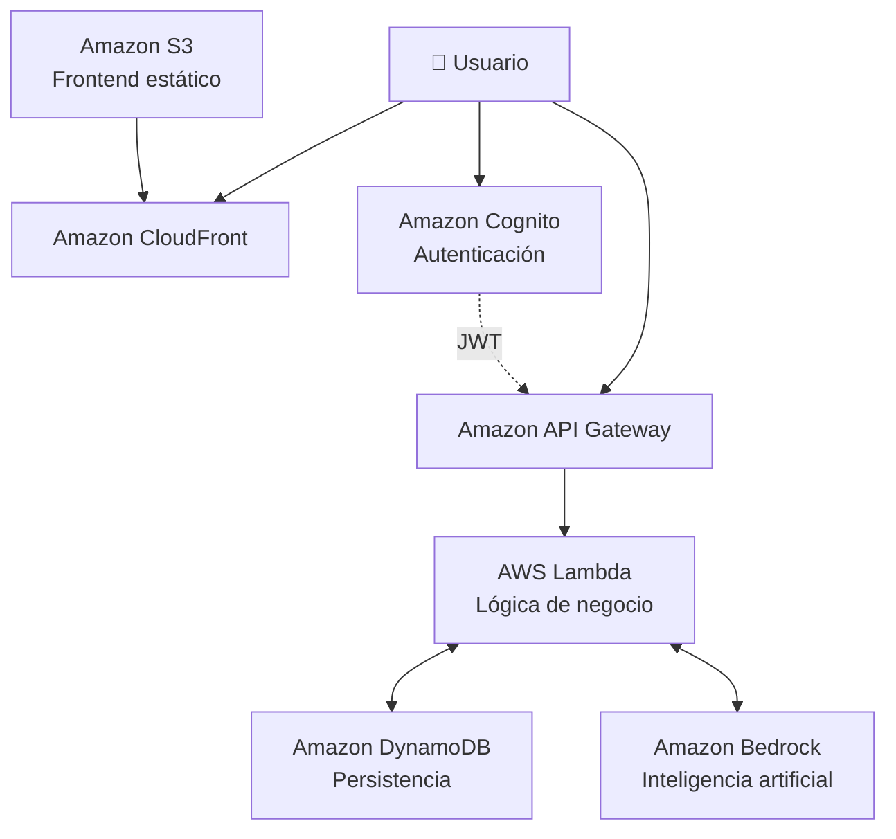

# 🌱 Dotol — Smart Task Management

<p align="center">
  <strong>Organiza tus actividades. Simplifica tu día. Deja que la IA te ayude.</strong>
</p>

<p align="center">
  
  
  
</p>

[English Version](README_ingles.md)

**Dotol** es una aplicación web de gestión de tareas que integra inteligencia artificial generativa para facilitar el registro y la organización de actividades mediante lenguaje natural.

El proyecto permite explorar dos formas de gestionar tareas: una modalidad tradicional basada en formularios y una modalidad conversacional en la que el usuario describe sus actividades a un asistente de IA, que genera propuestas para organizar su lista de tareas.

> 🎓 **Proyecto desarrollado en el marco de una investigación de tesis universitaria**, orientada a comparar la gestión de tareas mediante inteligencia artificial conversacional frente a métodos tradicionales de registro.

---

## ¿Qué es Dotol?

La organización de actividades académicas y personales puede convertirse en una tarea adicional cuando se necesita registrar, clasificar y actualizar cada pendiente manualmente.

Dotol busca simplificar este proceso mediante una interfaz que permite gestionar actividades de manera tradicional o utilizando un asistente conversacional impulsado por inteligencia artificial.

En lugar de completar múltiples campos, el usuario puede describir lo que necesita hacer utilizando lenguaje natural. El asistente interpreta el mensaje y genera una propuesta de acciones que el usuario puede revisar y aceptar antes de aplicarla.

**La inteligencia artificial propone; el usuario decide.**

## Funcionalidades principales

### Gestión tradicional de tareas
- Crear tareas mediante formularios.
- Editar y actualizar actividades.
- Marcar tareas como completadas.
- Eliminar tareas.
- Organizar actividades mediante categorías.

### Asistente conversacional con IA
- Registrar actividades utilizando lenguaje natural.
- Interpretar instrucciones escritas por el usuario.
- Generar propuestas estructuradas de tareas.
- Revisar las acciones propuestas antes de ejecutarlas.
- Aceptar o cancelar propuestas generadas por el asistente.

### Evaluación experimental
La aplicación incorpora un módulo de evaluación utilizado en el desarrollo de la investigación:

- Registro del tiempo de ejecución.
- Conteo de interacciones (clics).
- Cantidad de tareas registradas.
- Cuestionario Raw NASA-TLX para evaluar la carga de trabajo percibida.
- Cuestionario System Usability Scale (SUS) para evaluar la usabilidad percibida.

Estas mediciones permiten comparar ambas modalidades de interacción bajo un diseño experimental intra-sujetos.

### Autenticación y seguridad
- Registro e inicio de sesión de usuarios.
- Verificación de correo electrónico.
- Autenticación mediante Amazon Cognito.
- Protección de endpoints mediante tokens de autenticación.
- Separación de permisos para usuarios administradores.

---

## Arquitectura tecnológica

Dotol utiliza una arquitectura serverless desplegada sobre Amazon Web Services (AWS), separando la presentación, el procesamiento de solicitudes y el almacenamiento de información.

### Arquitectura general



### Tecnologías utilizadas

| Tecnología | Uso |
|---|---|
| React | Desarrollo de la interfaz de usuario |
| TypeScript | Tipado y organización del código frontend |
| CSS | Estilos y diseño visual |
| Amazon S3 | Almacenamiento del frontend |
| Amazon CloudFront | Distribución de contenido web |
| Amazon Cognito | Autenticación y gestión de usuarios |
| Amazon API Gateway | Exposición de servicios backend |
| AWS Lambda | Ejecución de la lógica de negocio |
| Amazon DynamoDB | Almacenamiento de datos |
| Amazon Bedrock | Integración con modelos de IA generativa |

---

## ¿Cómo funciona el asistente de IA?

El flujo conversacional está diseñado para mantener al usuario en control de sus actividades.

1. El usuario escribe una instrucción en lenguaje natural.
2. El mensaje se envía al backend.
3. Una función AWS Lambda procesa la solicitud e interactúa con Amazon Bedrock.
4. El modelo interpreta la instrucción y genera una propuesta estructurada.
5. La propuesta se presenta al usuario.
6. El usuario puede aceptar o cancelar las acciones propuestas.
7. Si acepta, el sistema ejecuta las modificaciones correspondientes.

Este enfoque evita que las acciones generadas por IA se apliquen automáticamente sin la aprobación del usuario.

---

## Investigación académica

Este proyecto forma parte del desarrollo de una tesis universitaria cuyo propósito es analizar el efecto del uso de inteligencia artificial conversacional en la gestión de actividades.

La investigación compara dos modalidades:

| Modalidad | Descripción |
|---|---|
| Tradicional | Registro y administración de tareas mediante formularios |
| Asistida por IA | Registro y administración de tareas mediante lenguaje natural y un asistente conversacional |

Se consideran cuatro dimensiones de evaluación:

- **Tiempo de registro:** duración de la ejecución de las actividades.
- **Esfuerzo de interacción:** cantidad de clics realizados.
- **Carga de trabajo percibida:** medida mediante Raw NASA-TLX.
- **Usabilidad percibida:** medida mediante System Usability Scale (SUS).

La evaluación utiliza un diseño intra-sujetos, donde cada participante interactúa con ambas modalidades siguiendo un orden asignado aleatoriamente.

Los datos obtenidos se utilizan con fines de investigación académica. Los resultados se analizan de manera agregada, sin publicar los nombres de los participantes ni examinar el contenido personal de sus tareas.

---

## Instalación y ejecución local

### Requisitos previos

- Node.js y npm.
- Git.
- Una cuenta de AWS.
- Configuración de los servicios AWS utilizados por el proyecto.

### 1. Clonar el repositorio

```bash
git clone https://github.com/TU-USUARIO/TU-REPOSITORIO.git
cd TU-REPOSITORIO
```

### 2. Instalar dependencias

```bash
cd frontend
npm install
```

### 3. Configurar variables de entorno

Crear un archivo `.env.local` dentro de la carpeta `frontend`, con las variables necesarias para conectar el frontend con los servicios de AWS.

```env
VITE_API_URL=TU_API_GATEWAY_URL
VITE_COGNITO_USER_POOL_ID=TU_USER_POOL_ID
VITE_COGNITO_CLIENT_ID=TU_CLIENT_ID
VITE_AWS_REGION=TU_AWS_REGION
```

**Importante:** Los nombres anteriores son ilustrativos. Verifica los nombres y valores exactos utilizados por el código fuente. Nunca publiques credenciales, claves privadas ni secretos en el repositorio.

### 4. Ejecutar en desarrollo

```bash
npm run dev
```

### 5. Generar compilación de producción

```bash
npm run build
```

Los archivos optimizados se generan en la carpeta `dist/`, listos para su despliegue en Amazon S3 y distribución mediante CloudFront.

---

## Despliegue

El frontend se despliega mediante Amazon S3 y Amazon CloudFront.

El backend utiliza servicios serverless de AWS para procesar las solicitudes, administrar los datos y conectar con el modelo de inteligencia artificial.

La infraestructura se configura mediante AWS CloudFormation.

---

## Estado del proyecto

**Dotol es un prototipo funcional desarrollado con fines de investigación académica.**

Actualmente contempla:
- Gestión tradicional de tareas.
- Gestión conversacional mediante IA.
- Autenticación de usuarios.
- Persistencia de información en la nube.
- Módulo de evaluación experimental.
- Despliegue web mediante AWS.

El proyecto puede evolucionar con futuras mejoras en experiencia de usuario, capacidades conversacionales y funcionalidades de organización personal.

---

## Autoría

Desarrollado como parte de un proyecto de tesis universitaria.

**Estudiante:** Navhi Giordano Andrade Saavedra  
**Proyecto:** Dotol — Smart Task Management  
**Área:** Inteligencia artificial aplicada a la gestión de tareas  
**Contexto:** Investigación académica universitaria  
**Tecnologías principales:** React, TypeScript y Amazon Web Services.

---

<p align="center">
  <strong>🌱 Dotol</strong><br/>
  <em>Less friction, more focus.</em>
</p>
