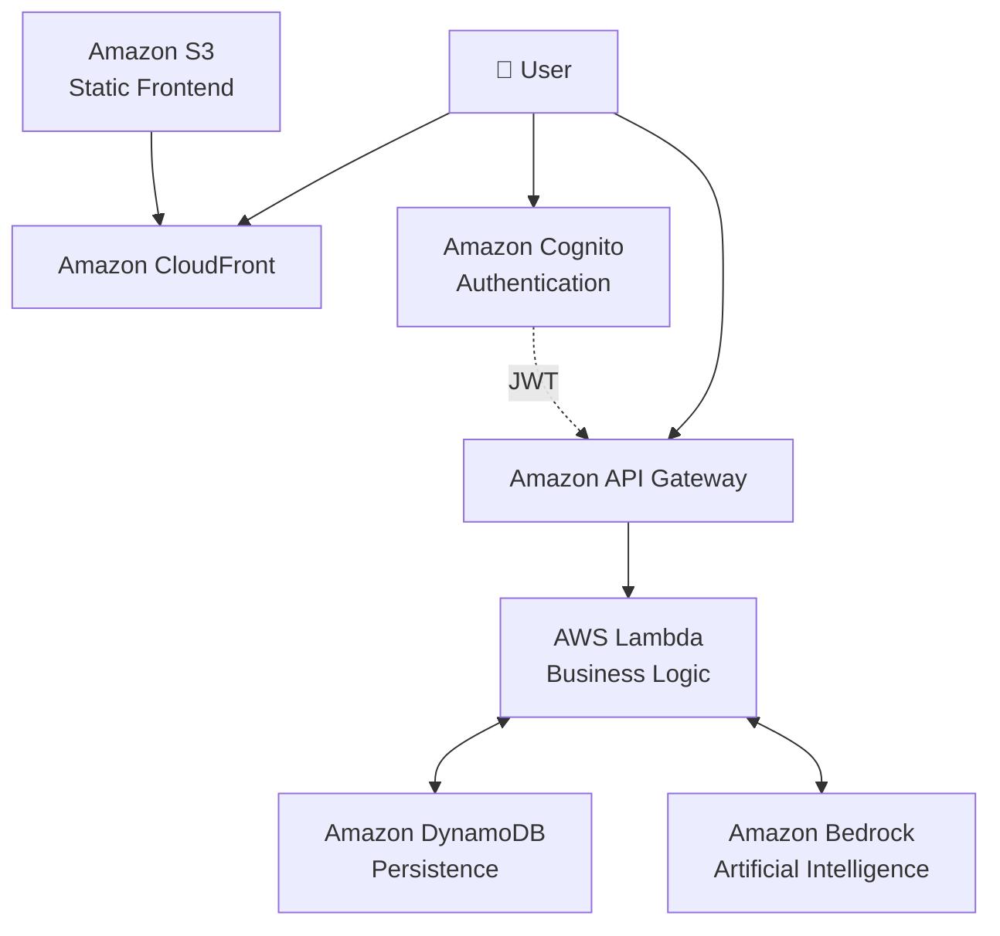

# 🌱 Dotol — Smart Task Management

<p align="center">
  <strong>Organize your activities. Simplify your day. Let AI help you.</strong>
</p>

<p align="center">
  
  
  
</p>

**Dotol** is a task management web application that integrates generative artificial intelligence to simplify logging and organizing activities through natural language.

The project explores two ways to manage tasks: a traditional form-based mode and a conversational mode in which the user describes their activities to an AI assistant, which generates proposals to organize their task list.

> 🎓 **Project developed as part of a university thesis research study**, aimed at comparing task management using conversational artificial intelligence against traditional logging methods.

---

## What is Dotol?

Organizing academic and personal activities can become an extra chore when every to-do item must be manually logged, categorized, and updated.

Dotol aims to simplify this process through an interface that lets you manage activities traditionally or by using a conversational assistant powered by artificial intelligence.

Instead of filling out multiple fields, the user can describe what they need to do using natural language. The assistant interprets the message and generates a proposed set of actions that the user can review and accept before applying them.

**Artificial intelligence proposes; the user decides.**

## Main Features

### Traditional Task Management
- Create tasks using forms.
- Edit and update activities.
- Mark tasks as completed.
- Delete tasks.
- Organize activities using categories.

### AI Conversational Assistant
- Log activities using natural language.
- Interpret instructions written by the user.
- Generate structured task proposals.
- Review proposed actions before executing them.
- Accept or cancel proposals generated by the assistant.

### Experimental Evaluation
The application incorporates an evaluation module used during the research study:

- Execution time tracking.
- Interaction count (clicks).
- Number of tasks logged.
- Raw NASA-TLX questionnaire to evaluate perceived workload.
- System Usability Scale (SUS) questionnaire to evaluate perceived usability.

These measurements allow comparing both interaction modes under a within-subjects experimental design.

### Authentication and Security
- User registration and login.
- Email verification.
- Authentication via Amazon Cognito.
- Endpoint protection using authentication tokens.
- Permission separation for administrator users.

---

## Technical Architecture

Dotol uses a serverless architecture deployed on Amazon Web Services (AWS), separating presentation, request processing, and data storage.

### General Architecture



### Technologies Used

| Technology | Purpose |
| --- | --- |
| React | User interface development |
| TypeScript | Frontend code typing and organization |
| CSS | Styling and visual design |
| Amazon S3 | Frontend hosting/storage |
| Amazon CloudFront | Web content distribution |
| Amazon Cognito | Authentication and user management |
| Amazon API Gateway | Backend service exposure |
| AWS Lambda | Business logic execution |
| Amazon DynamoDB | Data storage |
| Amazon Bedrock | Integration with generative AI models |

---

## How Does the AI Assistant Work?

The conversational flow is designed to keep the user in control of their activities.

1. The user writes an instruction in natural language.
2. The message is sent to the backend.
3. An AWS Lambda function processes the request and interacts with Amazon Bedrock.
4. The model interprets the instruction and generates a structured proposal.
5. The proposal is presented to the user.
6. The user can accept or cancel the proposed actions.
7. If accepted, the system executes the corresponding modifications.

This approach prevents AI-generated actions from being applied automatically without user approval.

---

## Academic Research

This project is part of a university thesis aimed at analyzing the effect of using conversational artificial intelligence in activity management.

The research compares two modes:

| Mode | Description |
| --- | --- |
| Traditional | Logging and managing tasks through forms |
| AI-Assisted | Logging and managing tasks through natural language and a conversational assistant |

Four evaluation dimensions are considered:

* **Logging time:** duration of activity execution.
* **Interaction effort:** number of clicks performed.
* **Perceived workload:** measured via Raw NASA-TLX.
* **Perceived usability:** measured via the System Usability Scale (SUS).

The evaluation uses a within-subjects design, where each participant interacts with both modes following a randomly assigned order.

The data obtained is used for academic research purposes. Results are analyzed in aggregate, without publishing participant names or examining the personal content of their tasks.

---

## Installation and Local Execution

### Prerequisites

* Node.js and npm.
* Git.
* An AWS account.
* Configuration of the AWS services used by the project.

### 1. Clone the repository

```bash
git clone [https://github.com/YOUR-USERNAME/YOUR-REPOSITORY.git](https://github.com/YOUR-USERNAME/YOUR-REPOSITORY.git)
cd YOUR-REPOSITORY
```

### 2. Install dependencies

```bash
cd frontend
npm install
```

### 3. Configure environment variables

Create a `.env.local` file inside the `frontend` folder with the variables required to connect the frontend to AWS services.

```env
VITE_API_URL=YOUR_API_GATEWAY_URL
VITE_COGNITO_USER_POOL_ID=YOUR_USER_POOL_ID
VITE_COGNITO_CLIENT_ID=YOUR_CLIENT_ID
VITE_AWS_REGION=YOUR_AWS_REGION
```

**Important:** The names above are illustrative. Verify the exact variable names and values used by the source code. Never publish credentials, private keys, or secrets in the repository.

### 4. Run in development mode

```bash
npm run dev
```

### 5. Generate a production build

```bash
npm run build
```

The optimized files are generated in the `dist/` folder, ready for deployment to Amazon S3 and distribution via CloudFront.

---

## Deployment

The frontend is deployed using Amazon S3 and Amazon CloudFront.

The backend uses AWS serverless services to process requests, manage data, and connect to the artificial intelligence model.

The infrastructure is configured using AWS CloudFormation.

---

## Project Status

**Dotol is a functional prototype developed for academic research purposes.**

It currently includes:

* Traditional task management.
* Conversational AI task management.
* User authentication.
* Cloud data persistence.
* Experimental evaluation module.
* Web deployment via AWS.

The project may evolve with future improvements in user experience, conversational capabilities, and personal organization features.

---

## Authorship

Developed as part of a university thesis project.

**Student:** Navhi Giordano Andrade Saavedra

**Project:** Dotol — Smart Task Management

**Area:** Artificial intelligence applied to task management

**Context:** University academic research

**Core Technologies:** React, TypeScript, and Amazon Web Services.

---